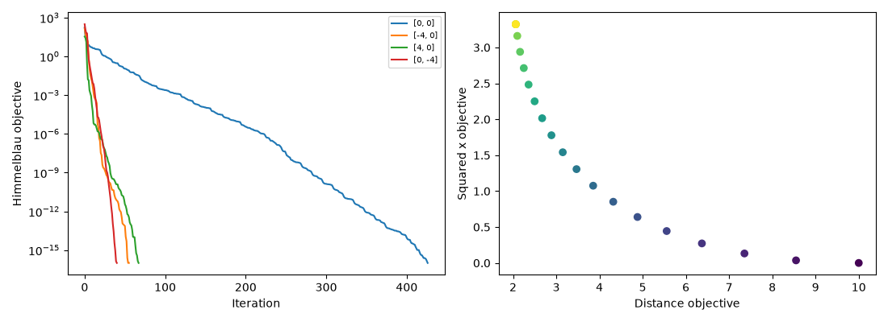

# Numerical Optimization Lab

Constrained extrema, trust regions, conjugate gradients, and Pareto tradeoffs.

**Author and maintainer:** Abhinav Tanwar.

## Run

Requires Python 3.12. Install dependencies with `python -m pip install -r requirements.txt`.

```sh
python analysis.py
python -m unittest discover -s tests
```

## Methods and limitations

Consolidates related numerical-method sections rather than presenting every exercise as a different product. Scalar and separable box extrema are certified by enumerating stationary and boundary candidates. Constrained projection includes a feasibility residual. Rosenbrock trust-region runs record optimizer status and gradient norms. Linear conjugate gradient checks symmetric positive-definite inputs and reports residuals and conditioning on Hilbert systems; a small residual alone does not establish an accurate solution. Nonlinear Fletcher–Reeves uses bounded backtracking and descent restarts. Weighted-sum Pareto points are candidates, not a claim that every Pareto solution was recovered.

## Measured results


[Full calculated metrics](results/metrics.json) · [Input provenance](data/README.md) · [Method changes](docs/methodology.md). Open `report.html` for the visual summary.

Generated examples and toy inputs are explicitly illustrative; they do not stand in for historical real-world outcomes.



The clean notebook in `notebooks/` delegates to the same module. Notebook cells were syntax-checked with outputs cleared; native scripts and tests were executed.
